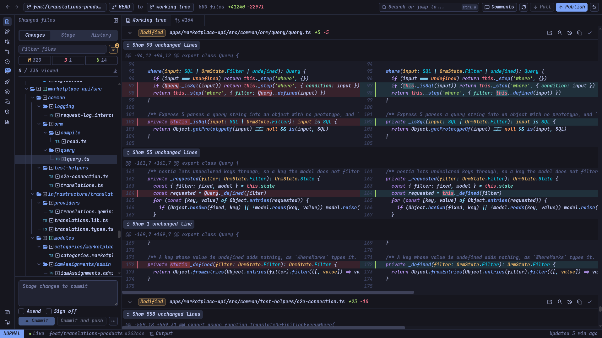
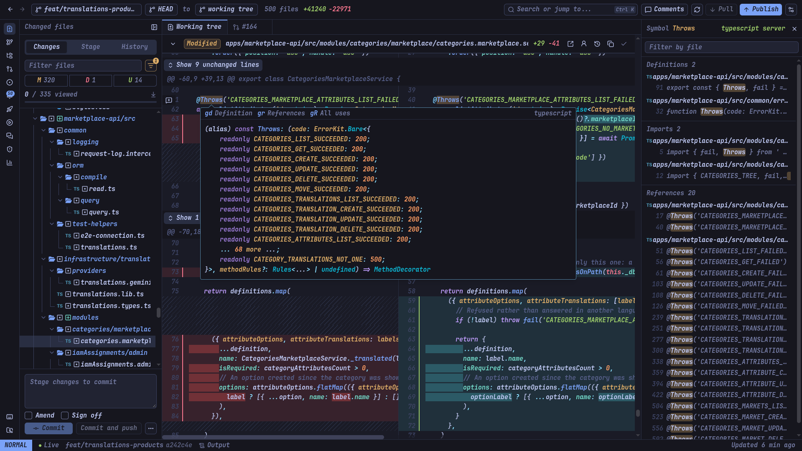

<p align="center">
  
</p>

<h1 align="center">@gentleduck/diff</h1>

<p align="center">
  A git diff viewer and GitHub client that lives in your browser, from the terminal or from Neovim.
</p>

<p align="center">
  <a href="./LICENSE">MIT</a> -
  <a href="./CHANGELOG.md">Changelog</a> -
  <a href="./CONTRIBUTING.md">Contributing</a> -
  <a href="./SECURITY.md">Security</a> -
  <a href="https://github.com/gentleeduck/duck-diff/releases">Releases</a>
</p>

<p align="center">
  <a href="https://github.com/gentleeduck/duck-diff/actions/workflows/ci.yml"></a>
  <a href="https://github.com/gentleeduck/duck-diff/releases/latest"></a>
  <a href="./LICENSE"></a>
</p>

---

Your changes, a branch, a range or a commit, rendered with [@pierre/diffs](https://diffs.com): split or stacked,
syntax highlighted, virtualized and live as you edit. Around it, the commit graph, the files, pull requests,
issues, notifications, actions and the rest of GitHub, a real terminal, and a few plain keys. One binary, no
cloud: it runs on your machine and opens in your browser.

<p align="center">
  
</p>

<p align="center">
  
</p>

## Install

```sh
curl -fsSL https://raw.githubusercontent.com/gentleeduck/duck-diff/main/install.sh | sh
```

It puts the binary for your machine (Linux or macOS, x64 or arm64) in `~/.local/bin` after checking its sha256
against the release. The page brings its own fonts (JetBrains Mono and the Nerd Font icons), so nothing else
needs installing. Options go after `sh -s --`:

```sh
curl -fsSL .../install.sh | sh -s -- --version 0.7.0   # a given release
curl -fsSL .../install.sh | sh -s -- --dir ~/bin       # another folder
curl -fsSL .../install.sh | sh -s -- --uninstall       # take it out again
```

`duck-diff update` replaces it with the newest release later.

### In Neovim

With [lazy.nvim](https://github.com/folke/lazy.nvim):

```lua
{ 'gentleeduck/duck-diff', cmd = 'DuckDiff', opts = {} }
```

The first `:DuckDiff` downloads the binary matching the plugin, checks its sha256 and keeps it under
`stdpath('data')/duck-diff`. `:checkhealth duck-diff` says what is off.

## Quick start

```sh
cd your-repo
duck-diff                  # what you changed
duck-diff main             # what this branch adds on top of main
duck-diff prs 12           # pull request #12
duck-diff --help           # the rest
```

It opens the page as an app window (Chrome, Chromium or Brave; the default browser otherwise) and keeps serving
until Ctrl-C, or until no page has been open for a while. A second `duck-diff` in the same repo opens its page on
the server already running.

From Neovim it is `:DuckDiff`, with the same targets.

## What it does

- **Changes**: the diff in tabs (working tree, commits, ranges, pull requests), a file tree with filters, hide
  patterns and viewed marks, stage, unstage and discard by file, hunk or selected lines, blame on both sides,
  comments that follow their line, and a commit box (amend, sign off, commit and push).
- **Commit graph**: every branch's lanes, find by message, author or sha; check out, branch, cherry-pick, revert,
  rebase interactively, bisect, worktrees and submodules.
- **Files**: the whole tree, markdown rendered, blame and history per file, go to definition and references
  through language servers.
- **Merges**: conflicts shown as GitHub shows them (the current and incoming change against their merge base,
  with each side's branch and commit), split or stacked like the diff, resolved block by block or as text, with
  blame on every side and each side's commits to the file; a merge, rebase, pick or revert in progress shows on
  every page and in the bottom panel, wherever it began.
- **GitHub**: pull requests and issues with their conversations, reviews and review threads in the diff, merge
  with every method, checks and logs, notifications, releases, actions, discussions and security alerts.
- **Terminal and output**: real shells in a bottom panel, and every git action's command and output, hooks
  included. Ctrl+C, Ctrl+Z and job control work as in any terminal; Ctrl+Shift+C (or Ctrl+C with text selected)
  copies and Ctrl+V or Ctrl+Shift+V pastes.
- **Keys**: a few plain ones: `Ctrl P` searches, `j`/`k` step through changes, `s`/`u`/`x` stage, unstage and
  discard, Ctrl+H/J/K/L move between panels, arrows walk lists. `?` or the keyboard button on the rail lists
  them all.
- **Themes**: ten dark ones. There is a light button. It does not do what you think.

Open on any file goes to the Neovim you started duck-diff from, else to VS Code at the line (then VSCodium,
Cursor, Windsurf, Zed or Sublime), else to the app your system opens the file with. Never a terminal in the page.

## Command line

| Command | Opens |
| --- | --- |
| `duck-diff` | your uncommitted changes |
| `duck-diff staged` / `unstaged` | one side of the index |
| `duck-diff <ref>` | what this branch adds on top of `<ref>` |
| `duck-diff a...b` / `a..b` | any two refs, since they split or tip to tip |
| `duck-diff commit [sha]` | one commit |
| `duck-diff graph` / `files [path[:line]]` / `prs [n]` / `issues [n]` / `inbox` | a view |
| `duck-diff update [version]` | the newest release, over this binary |
| `duck-diff cache clear` | empties the GitHub and commit caches |
| `duck-diff git-setup [--off]` | makes duck-diff git's merge tool, diff tool and rebase editor (the install does this) |
| `duck-diff serve` | the server alone, for editor plugins (one line of JSON on stdout) |

Options: `-C <path>` another repo, `--no-open` print the url, `-p <port>`, `--no-terminal`.

## As git's tools

The install makes duck-diff the tool git opens, wherever you have not chosen another (`duck-diff git-setup`;
`--off` undoes it):

| You run | duck-diff |
| --- | --- |
| `git mergetool` | resolves the conflicts of a merge, cherry-pick, revert, rebase or stash pop, in a window with only them |
| `git difftool` | shows each file, the next one when you click Next file |
| `git rebase -i` | plans the rebase as a list instead of a text file (a todo with exec or merge lines opens your editor) |

The window closes once git has what it asked for, and the terminal carries on.

## Neovim options

```lua
opts = {
  open = 'app',       -- 'app' (Chrome app window), 'tab' (default browser) or function(url)
  browser = nil,      -- browser command for app windows; detected when nil
  binary = nil,       -- your own duck-diff binary
  github_token = nil, -- for downloads from a private fork
  server = { idle_timeout_ms = 600000 },
  git_setup = true,   -- make each downloaded binary git's merge tool, diff tool and rebase editor
}
```

| Command | Does |
| --- | --- |
| `:DuckDiff [target]` | opens a diff, targets as above |
| `:DuckDiff status` / `close` | the server for this repo |
| `:DuckDiff build` | builds the binary from this checkout with Bun |

## Where things live

Everything duck-diff keeps is in one folder, `~/.duck-diff` (set `DUCK_DIFF_HOME` to move it), not in the browser:
clearing the browser loses none of it.

- `state.json`: settings, panel sizes, and each repo's open tabs, viewed files and unsent reviews.
- `repos.json`: the repositories the switcher lists.
- `<repo id>/`: that repo's comments (`reviews.json`), undo snapshots for discards, and its cache of GitHub and
  commit answers (`duck-diff cache clear` empties the caches).

Data from older versions, in `~/.local/share/duck-diff` and `~/.cache/duck-diff`, moves here the first time a newer
duck-diff starts. The Neovim plugin's downloaded binaries stay in Neovim's own data folder. The GitHub token never
reaches the page.

## Workspace

| Path | Role |
| --- | --- |
| [`apps/server`](apps/server) | the Bun server and CLI, compiled to one binary with the page inside |
| [`apps/web`](apps/web) | the page: React, TanStack Router and Query, [duck-ui](https://github.com/gentleeduck/duck-ui) |
| [`packages/git`](packages/git) | every git command, run from one place |
| [`packages/protocol`](packages/protocol) | zod schemas shared by the server and the page |
| [`packages/ui`](packages/ui) | the duck-ui components the page uses |
| [`packages/testing`](packages/testing) | throwaway repos for tests |
| [`lua/duck-diff`](lua/duck-diff) | the Neovim plugin |

## Development

```sh
bun install
bun run ci          # biome, types, build, unit tests with coverage
bun run test:e2e    # Playwright against the compiled binary
bun run test:nvim   # Lua specs in headless Neovim
bun run bench       # performance budgets against the compiled binary
```

The budgets: the first diff row within 300 ms for 1,000 changed files, under 300 MB of JS heap for a
50,000-line diff, and 60 fps while scrolling and while a shell floods the terminal. CI checks them on Linux.
See [CONTRIBUTING.md](./CONTRIBUTING.md) for the rest.

## License

[MIT](./LICENSE)
